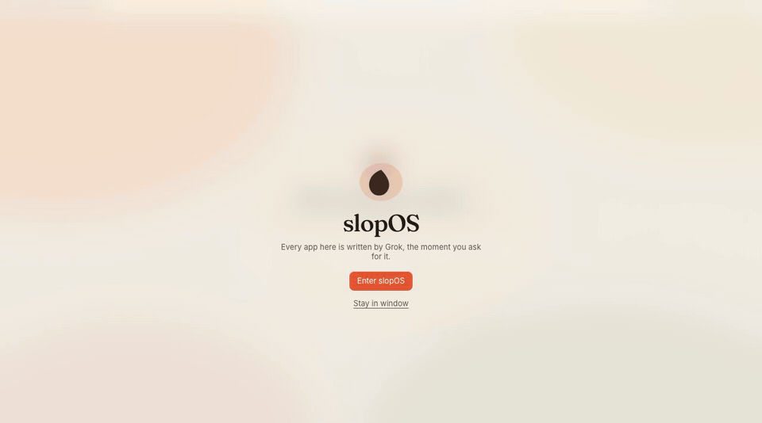
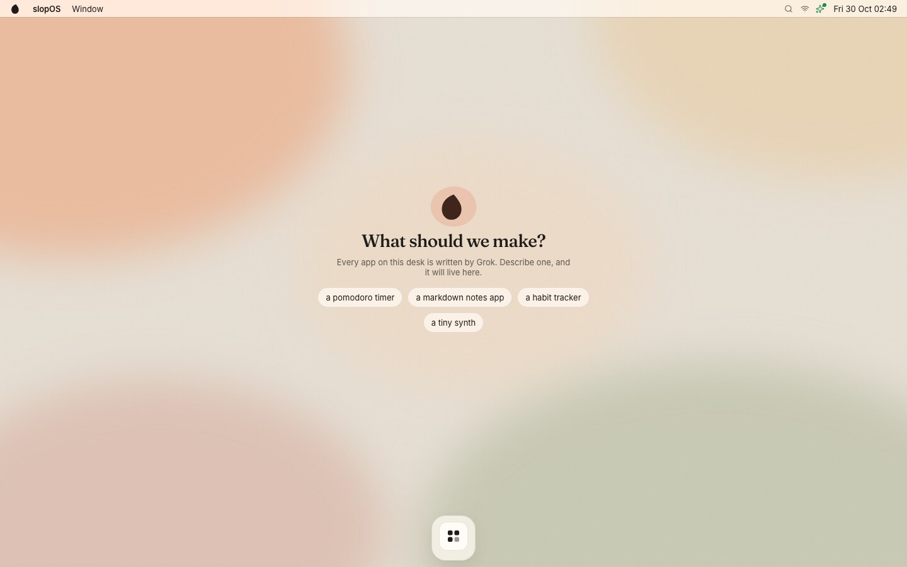
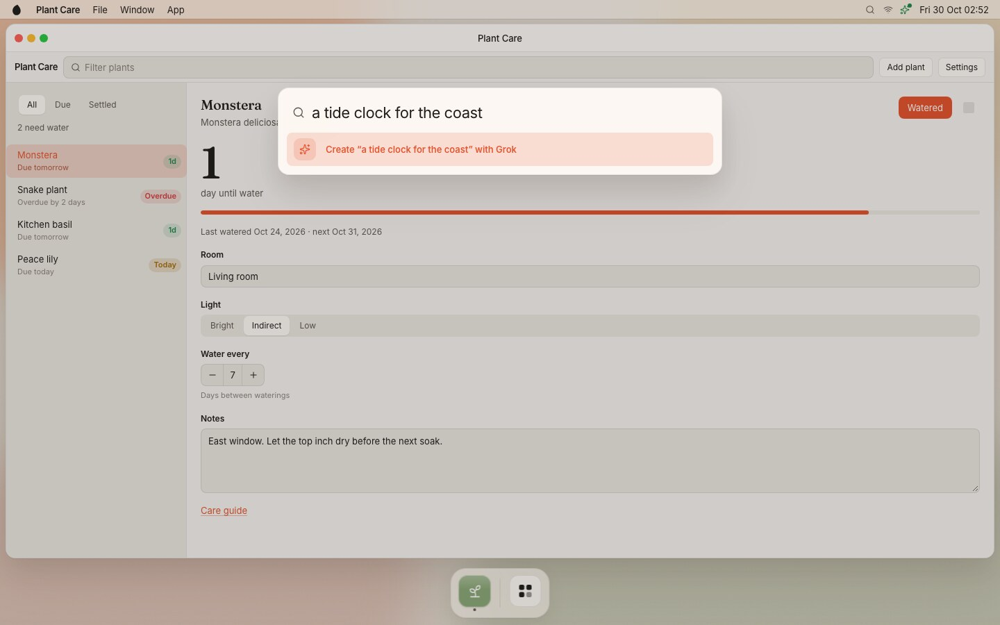
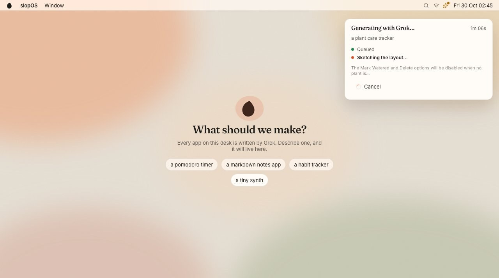
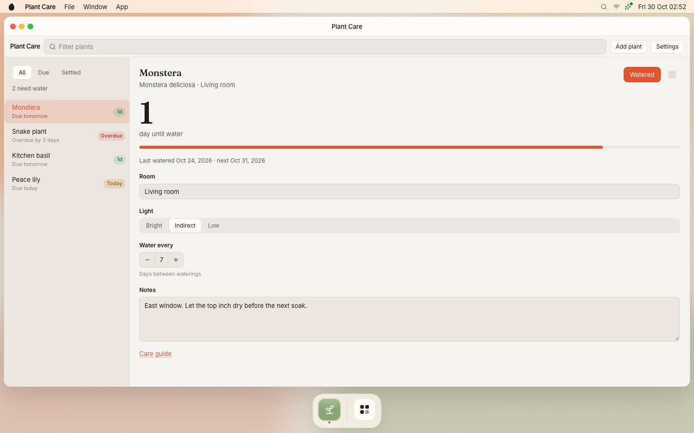
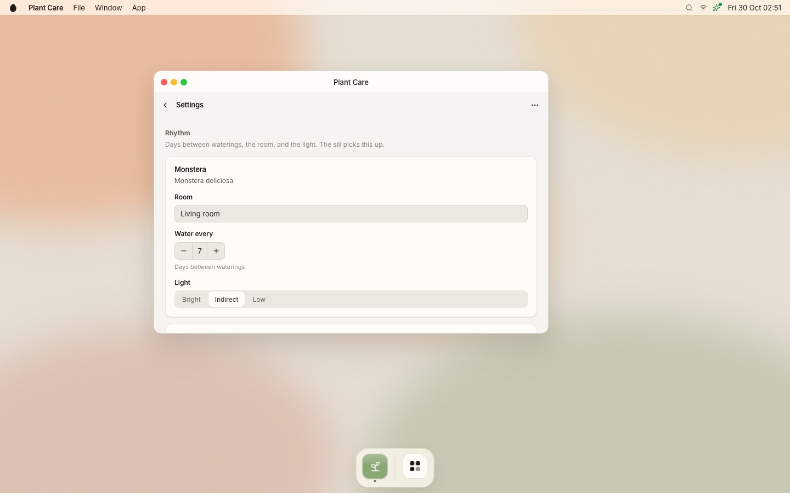
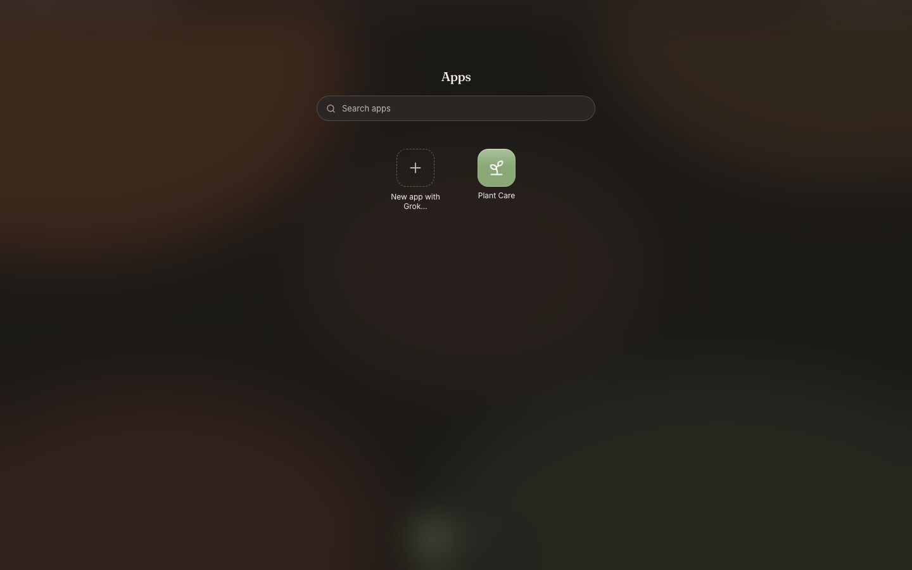

# slopOS

**A desktop in your browser where every app is written on the spot.**

slopOS is a calm, slightly playful take on a macOS-style desktop: menu bar, dock, windows with traffic lights, Spotlight, an app drawer. It ships with **no apps at all**. You describe one, and a coding agent (Grok by default, or Codex or Claude) writes it as a single React file. The app compiles, runs sandboxed in a window, and stays on your desk.



<sub>A real session with Grok (grok-4.7, medium effort). The waits are fast-forwarded: the app took about 2½ minutes and the generated Settings screen about a minute. Also available as <a href="docs/demo.mp4">MP4</a>.</sub>

## The idea: an infinite, procedurally generated world

Generating apps from a search box is the start. In slopOS, **every search bar and every button can lead somewhere that doesn't exist yet**:

- **Spotlight** finds your apps, the screens inside them, and things that live in your world. If nothing matches, it offers to create it.
- **Buttons inside generated apps** that have no handler (a "Settings" button, a "More…" link, a detail row) are *generative*. Click one and the screen behind it materializes in the same window, with a back button.
- **Search fields** inside apps work the same way and generate a results screen for your query.
- **Content** such as articles, sample records or headlines can be generated by apps on demand, as structured JSON.

It stays **coherent**. A world store remembers every app, what data it keeps, the people, places and things that were invented, and what was generated before. Every generation gets a compact digest of that world, so a meal planner reuses the dinners from your recipe box and a news reader writes about them. Results are cached: the same button leads to the same screen.

It **persists**. Apps, generated screens, content, app data, open windows and their screen stacks survive reloads and restarts, so you continue where you left off. **Reset slopOS** in the logo menu wipes the world and returns to the pristine first start.

## Screenshots

| | |
|---|---|
|  |  |
|  |  |
|  |  |

## Quick start

Requirements: Node 20+ and **one** generator CLI installed and signed in with your subscription:

| Provider | CLI | Sign in once with | Default model / effort |
|---|---|---|---|
| `grok` (default) | [Grok CLI](https://x.ai) `grok` | run `grok` and log in (SuperGrok) | `grok-4.7` / `medium` |
| `codex` | [Codex CLI](https://github.com/openai/codex) `codex` | `codex login` (ChatGPT) | CLI default / `medium` |
| `claude` | [Claude Code](https://claude.com/claude-code) `claude` | run `claude` and log in (Claude subscription) | CLI default / `medium` |

```bash
git clone https://github.com/marvinvr/slopOS.git
cd slopOS
npm install
cp .env.example .env      # optional: pick a provider, model, effort, port
npm start                 # builds, then serves on http://0.0.0.0:4747
```

Open http://localhost:4747, choose **Enter slopOS** for full screen, press **Ctrl+Space** and describe an app.

**No API keys, ever.** slopOS only drives the local CLI you're already logged into. It never calls a vendor HTTP API, and it strips `XAI_API_KEY`, `GROK_API_KEY`, `OPENAI_API_KEY` and `ANTHROPIC_API_KEY` from the generator's environment so nothing silently bills an API account. If the CLI is missing or signed out, slopOS still runs and tells you how to fix it.

Other scripts:

```bash
npm run dev            # shell on :5173 with hot reload, API + runtime on :4748
npm run typecheck
npm run test:gen       # the full generation pipeline against the mock provider
npm run check:fixtures # compiles the hidden test apps and the SDK doc examples
```

## Generator providers

`SLOPOS_GENERATOR` in `.env` selects one of `grok`, `codex`, `claude` or `mock`. Each provider has exactly one code path and there are no silent fallbacks: if it fails, the UI says so.

- **grok** runs a long-lived `grok agent stdio` process and speaks the [Agent Client Protocol](https://agentclientprotocol.com) to it (`@agentclientprotocol/sdk`). Model and reasoning effort are set per session, and each app keeps its own session, so edits, fixes and new screens continue the same conversation.
- **codex** runs `codex exec --json` sandboxed to the app's workspace.
- **claude** uses the Claude Agent SDK with only Read/Write/Edit allowed and no user settings, skills or MCP servers loaded.
- **mock** produces realistic fake runs for tests and screenshots.

Every run happens in a per-app workspace under `data/workspaces/`. The agent may only read and write files there: no shell, no web, no subagents. Model and effort are configurable per provider and per kind of generation (`SLOPOS_GROK_MODEL`, `SLOPOS_GROK_EFFORT`, `SLOPOS_GROK_MODEL_CONTENT`, …). See [`.env.example`](.env.example) for everything, including timeouts and queue concurrency.

## How generated apps work

An app is a folder with a `manifest.json` (name, lucide icon, window size) and **one `app.tsx` file** that default-exports a React component. It may only import from `react` and `@slop/sdk`:

```tsx
import { Button, Row, Stack, Stat, Toolbar, useStorage } from '@slop/sdk'

export default function App() {
  const [count, setCount] = useStorage('count', 0)
  return (
    <Stack fill>
      <Toolbar title="Counter" />
      <Stack padding={20} gap={12}>
        <Stat value={count} label="clicks so far" />
        <Row gap={8}>
          <Button variant="primary" onClick={() => setCount((c) => c + 1)}>Add one</Button>
          <Button>Statistics</Button>{/* no handler: clicking it generates that screen */}
        </Row>
      </Stack>
    </Stack>
  )
}
```

The pipeline: prompt → the agent writes `App.tsx` + `manifest.json` → the server checks the imports and compiles with esbuild → on a compile error the same session gets the errors back (up to three attempts) → the app runs in a sandboxed iframe (`sandbox="allow-scripts"`, no same-origin) and talks to the shell only via `postMessage`. If a fresh app crashes on first launch, slopOS asks the agent to fix it once, automatically. Every edit is a new version you can restore from **Version History**.

`@slop/sdk` gives apps:

- **A design kit** of Button, Input, List, Table, Tabs, Dialog, SplitView, Stat, EmptyState and more, all built on shared design tokens, so generated apps look like they shipped with the OS.
- **System hooks:** `useStorage` (per-app storage on the server), `useWindow`, `useMenu` (menus in the menu bar), `notify`, `slopFetch` (a server-side fetch proxy), `useAppData` (read another app's data), clipboard, download, `confirm`.
- **The generative API:** `generate`, `useGenerated` (schema-typed content), `<GenerativeView>`, `openGenerative`, `useGenContext` (what's on screen) and `useScreens` (the in-window screen stack).

The full contract, written for an LLM author, is [`docs/APP_SDK.md`](docs/APP_SDK.md). The engineering spec is [`docs/SPEC.md`](docs/SPEC.md).

## Good to know

- **Generation takes a while.** With Grok on medium effort a new app takes about 2–4 minutes and a generated screen about 1–2 minutes. Codex and Claude are much faster (roughly 10–60 seconds). Lower effort (`SLOPOS_GROK_EFFORT=low`) cuts Grok to well under two minutes. slopOS shows live progress, and everything is cached once generated.
- **Generated code runs sandboxed** in an iframe without same-origin access and talks to the shell only through `postMessage`. Network access goes through the server's `slopFetch` proxy.
- **One world per server.** Everything lives in `data/` (or `SLOPOS_DATA_DIR`). Back that folder up to keep your world, or use Reset slopOS to start over.

## Keyboard

| | |
|---|---|
| Ctrl/Cmd + Space, Ctrl/Cmd + K | Spotlight |
| Ctrl/Cmd + Shift + A | App drawer |
| Ctrl/Cmd + Shift + F | Full screen |
| Ctrl/Cmd + W / M | Close / minimize window |
| Ctrl + ` (hold) | Switch windows |
| Ctrl + Alt + ← / → / ↑ / ↓ | Snap left / right / maximize / restore |
| Ctrl + / | All shortcuts |

Ctrl always works. Cmd works wherever the browser lets the page have it, and in full screen on Chromium slopOS uses the Keyboard Lock API so Esc and Ctrl/Cmd+W reach it.

## Project layout

```
server/            HTTP server: the shell, /runtime, /api
  apps/            app registry, esbuild compile, per-app storage
  generator/       providers (grok, codex, claude, mock), queue, prompts, world store
web/src/shell/     desktop, windows, menu bar, dock, Spotlight, drawer, generation UI
web/src/design/    design tokens and the component kit
runtime/           the sandboxed iframe runtime and @slop/sdk
fixtures/apps/     hidden test apps (only with SLOPOS_FIXTURES=1)
data/              your world: apps, screens, storage, settings (gitignored)
docs/              APP_SDK.md, SPEC.md, demo and screenshots
```

## License

[MIT](LICENSE)
